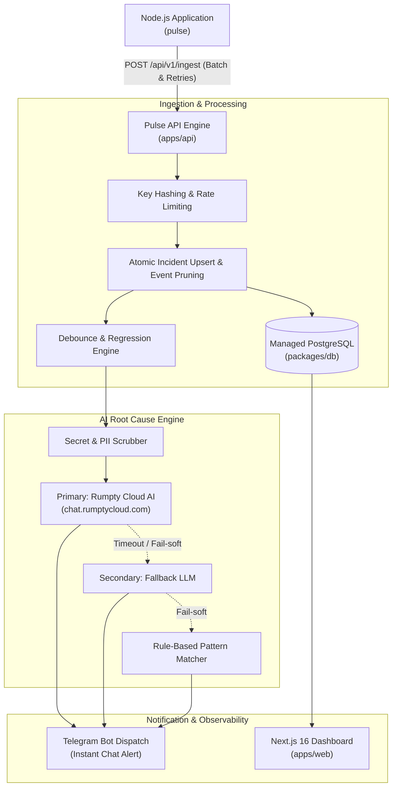

# Pulse ⚡

Real-time crash alerting and AI root-cause diagnosis infrastructure for applications deployed on Rumpty Cloud.

## Live Deployment Links

- Dashboard: {{LIVE_DASHBOARD_URL}}
- Ingest API: {{LIVE_API_URL}}
- Video Walkthrough: {{DEMO_VIDEO_URL}}

---

## Why Pulse Exists

Rumpty Cloud provides Git deployments with automated container rebuilds, but it provides no runtime logs, metrics, or alerting API. Specifically:
- VM metrics are dashboard charts only.
- Deployment logs are build logs only.
- Audit logs capture account-level administrative actions only.

When an application crashes or throws uncaught exceptions at runtime on Rumpty Cloud, developers receive no automated push alerts or diagnostic telemetry. Pulse closes this gap. It captures application exceptions via a lightweight Node.js SDK, clusters identical errors into incidents, generates AI-driven root-cause explanations with heuristic fallbacks, and delivers real-time incident notifications directly to Telegram.

---

## Architecture Overview



### Monorepo Packages

| Package / App | Purpose | Technology |
|---|---|---|
| [`packages/sdk`](./packages/sdk) | Client error telemetry SDK (`pulse`) | TypeScript, tsup (CJS, ESM, DTS) |
| [`packages/db`](./packages/db) | Database schema, migrations, and Prisma client | Prisma 6, PostgreSQL |
| [`apps/api`](./apps/api) | High-throughput ingest API, deduplication, AI pipeline | Express 4, tsup, Zod |
| [`apps/web`](./apps/web) | Authenticated incident dashboard and key management | Next.js 16 (Turbopack), TailwindCSS |
| [`examples/demo-app`](./examples/demo-app) | Sample application instrumented with Pulse | Express, Docker |

---

## 5-Minute SDK Quickstart

### 1. Install the SDK

```bash
npm install pulse
# or
pnpm add pulse
```

### 2. Initialize in Your Application

Initialize `pulse` at the earliest entry point before any other modules load:

```typescript
import pulse from "pulse";

pulse.init({
  apiKey: process.env.PULSE_API_KEY || "",
  endpoint: process.env.PULSE_ENDPOINT || "https://api.yourdomain.com/api/v1/ingest",
  environment: process.env.NODE_ENV || "production",
  release: process.env.APP_VERSION || "1.0.0",
});
```

### 3. Attach Express Middleware

Attach `pulse.errorHandler()` as an error middleware after your route definitions:

```typescript
import express from "express";
import pulse from "pulse";

const app = express();

// Application routes
app.get("/", (req, res) => res.send("OK"));

// Attach Pulse error middleware
app.use(pulse.errorHandler());

// Fallback client error response
app.use((err, req, res, next) => {
  res.status(500).json({ error: "Internal Server Error" });
});

app.listen(process.env.PORT || 3000);
```

### 4. Manual Error Capture

Capture handled exceptions or background worker failures with structured metadata:

```typescript
try {
  await executeDatabaseQuery();
} catch (error) {
  pulse.captureError(error, {
    tenantId: "cust_9876",
    action: "database_sync",
  });
}
```

---

## Telegram Bot Setup Guide

1. Open Telegram and message [@BotFather](https://t.me/BotFather) to create a new bot using `/newbot`.
2. Save the API token generated by BotFather (e.g., `123456789:ABCdefGhIJKlmNoPQRsTUVwxyZ`).
3. Set `TELEGRAM_BOT_TOKEN`, `TELEGRAM_BOT_USERNAME`, and a random `TELEGRAM_WEBHOOK_SECRET` in your API environment.
4. After deploying the API, register the webhook with Telegram:

```bash
pnpm --filter @pulse/api telegram:set-webhook
```

5. Log in to the Pulse Dashboard, create or open a project, and navigate to the Telegram tab.
6. Click the deep link to start the bot in your group or direct message chat:
   ```text
   https://t.me/YourBotUsername?start=<ONE_TIME_TOKEN>
   ```
7. Send the `/start` command with the token to link the chat. Future incidents will trigger instant push notifications.

---

## Security Model

Pulse adheres to strict production security practices:

- **Hashed API Keys:** API keys follow the format `pulse_live_<32 hex chars>`. Keys are hashed using SHA-256 before storage in PostgreSQL (`keyHash`). The plain key is displayed exactly once upon generation. Ingest requests hash the incoming key before query lookup.
- **Dashboard Basic Auth Gate:** All dashboard pages and `/api/projects/**` routes are protected by HTTP Basic Auth using constant-time string comparisons (`crypto.timingSafeEqual`). In production, omitting `DASHBOARD_PASSWORD` fails closed with HTTP 503.
- **Rate Limiting:** Ingest endpoints enforce rate limits of 120 requests per minute per API key (falling back to client IP), returning HTTP 429 with standard `Retry-After` headers.
- **Secret and PII Scrubber:** Error stack traces and metadata objects are scrubbed before reaching any LLM provider. Scrubbers redact Bearer tokens, `pulse_live_*` API keys, long hex and base64 strings, email addresses, and keys matching sensitive keywords (`password`, `token`, `secret`, `authorization`, `cookie`, `key`).
- **Telegram Webhook Verification:** Incoming Telegram webhook requests are validated using constant-time verification of header `X-Telegram-Bot-Api-Secret-Token`.
- **Single-Use Link Tokens:** Telegram verification tokens are single-use and expire 24 hours after creation.

---

## Environment Variables Reference

| Variable | Service | Required in Prod | Default | Description |
|---|---|---|---|---|
| `DATABASE_URL` | Database / API / Web | Yes | - | PostgreSQL connection string. For Rumpty SSL, append `?sslmode=require`. |
| `PUBLIC_API_URL` | API | Yes | - | Public internet URL for API (used for Telegram webhooks). |
| `PORT` | API / Web | No | `3001` (API) / `3000` (Web) | HTTP listening port. Honors container environment assignment. |
| `NODE_ENV` | API / Web | Yes | `production` | Operational environment mode. |
| `DASHBOARD_USER` | Web | No | `admin` | HTTP Basic Auth username for web dashboard. |
| `DASHBOARD_PASSWORD` | Web | Yes | - | HTTP Basic Auth password. Fails closed with 503 if missing in production. |
| `DASHBOARD_URL` | API | Yes | - | Web dashboard URL included in Telegram incident alerts. |
| `INTERNAL_API_URL` | Web | No | `http://localhost:3001` | Internal URL used by Next.js rewrites to communicate with API. |
| `INTERNAL_INGEST_URL` | Web | No | `http://localhost:3001/api/v1/ingest` | Internal endpoint used by dashboard simulator. |
| `CORS_ORIGINS` | API | No | `http://localhost:3000` | Comma-separated allowed origins for dashboard API calls. |
| `ALERT_DEBOUNCE_WINDOW_MINUTES` | API | No | `5` | Window in minutes to suppress duplicate alerts for recurring errors. |
| `RETENTION_DAYS` | API | No | `30` | Number of days before historical error events are automatically pruned. |
| `RUMPTY_AI_ENDPOINT` | API | No | `https://chat.rumptycloud.com/v1/chat/completions` | Rumpty Cloud OpenAI-compatible inference endpoint. |
| `RUMPTY_AI_API_KEY` | API | No | `""` | Rumpty AI API key. When unset, falls back to rule-based heuristics. |
| `RUMPTY_AI_MODEL` | API | No | `""` | Active model identifier from `GET /v1/models`. |
| `AI_FALLBACK_ENDPOINT` | API | No | `""` | Optional secondary OpenAI-compatible endpoint (e.g. Groq, Together). |
| `AI_FALLBACK_API_KEY` | API | No | `""` | Optional secondary API key. |
| `AI_FALLBACK_MODEL` | API | No | `""` | Optional secondary model identifier. |
| `TELEGRAM_BOT_TOKEN` | API | Yes | `""` | Bot token from @BotFather. |
| `TELEGRAM_BOT_USERNAME` | API / Web | No | `PulseMonitorBot` | Bot username handle without @. |
| `TELEGRAM_WEBHOOK_SECRET` | API | Yes | `""` | Shared secret token for webhook verification. |
| `TELEGRAM_API_BASE` | API | No | `https://api.telegram.org` | Base URL for Telegram Bot API (customizable for testing). |

---

## Local Development & Docker

### Local Repository Setup

```bash
git clone https://github.com/samkiell/Pulse.git
cd Pulse
pnpm install
cp .env.example .env
```

Start the local database:

```bash
docker compose up -d
pnpm db:deploy
```

Start development servers:

```bash
pnpm dev
```

### Production Docker Compose

Run the production multi-container stack locally:

```bash
docker compose -f docker-compose.prod.yml up --build
```

---

## Production Deployment to Rumpty Cloud

For complete step-by-step instructions on deploying the database, API, dashboard, and demo app to Rumpty Cloud, see [Deployment Guide](docs/DEPLOYMENT.md).

---

## Dashboard Interface Mockup

```text
+-----------------------------------------------------------------------------------+
|  Pulse Observability Dashboard                                      Project: Prod |
+-----------------------------------------------------------------------------------+
|  Active Incidents (2)     Total Occurrences: 1,482        Alert Status: Active    |
|                                                                                   |
|  [CRITICAL] DatabaseConnectionError: connect ECONNREFUSED 127.0.0.1:5432         |
|  Status: OPEN | First: 14m ago | Last: 1m ago | Total: 42 events                  |
|  Diagnosis [AI]: Postgres host is unreachable or rejected connection pool.       |
|  Suggested Fix: Verify DATABASE_URL hostname and ensure managed DB is running.    |
|                                                                                   |
|  [HIGH] TypeError: Cannot read properties of undefined (reading 'headers')        |
|  Status: RESOLVED | First: 2h ago | Last: 45m ago | Total: 8 events               |
|  Diagnosis [Rule-Based]: Null reference encountered during request parsing.      |
+-----------------------------------------------------------------------------------+
```

Visual UI assets and application screenshots are available in [docs/images/](docs/images/).

---

## Verification & Test Commands

Run the full test suite across the monorepo:

```bash
pnpm test
```

Run TypeScript verification across all workspace packages:

```bash
pnpm typecheck
```

Build all packages and applications:

```bash
pnpm build
```

---

## License

MIT (c) 2026 Samuel Ezekiel. See [LICENSE](LICENSE) for details.
